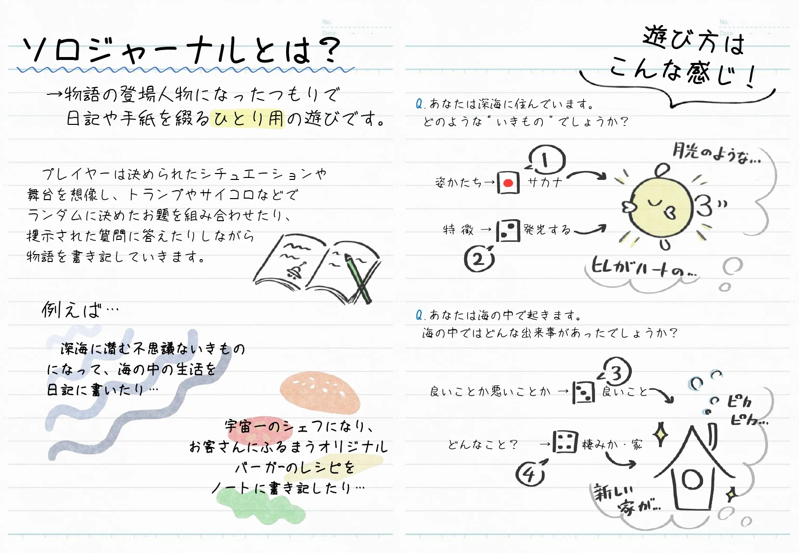

宇宙の果ての小さな惑星でバーガー屋を営むシェフになり、オリジナルバーガーのレシピをノートに書き綴る、ひとり用のジャーナリングRPGです。サイコロでバンズや具材、ソースを決めて、惑星いちばんのバーガーをつくります。

舞台は、食べることが大好きな住人たちが暮らす「バーガー・プラネット」。あなたはこの惑星にお店を開いた宇宙一のシェフです。店長の名前とお店のコンセプトを決めたら、ふわふわバンズにジューシーお肉、あま〜いソースといった食材をサイコロで選んで、今日のバーガーを考えます。名前をつけて売り出したら、何個売れたかもサイコロで決まります。

## ジャーナリングRPGとは

ジャーナリングRPG（ソロジャーナルとも呼ばれます）は、ひとりで遊ぶゲームです。ゲームごとに用意された舞台やシチュエーションを想像し、物語の登場人物になったつもりで、日記や手紙を書き綴って遊びます。サイコロやカードでランダムに決めたお題を組み合わせたり、問いかけに答えたりしながら、自分だけの物語を書いていきます。

ソロジャーナルの説明資料は、ましゅう様（[X](https://x.com/marshuumallow)）に制作していただきました。
