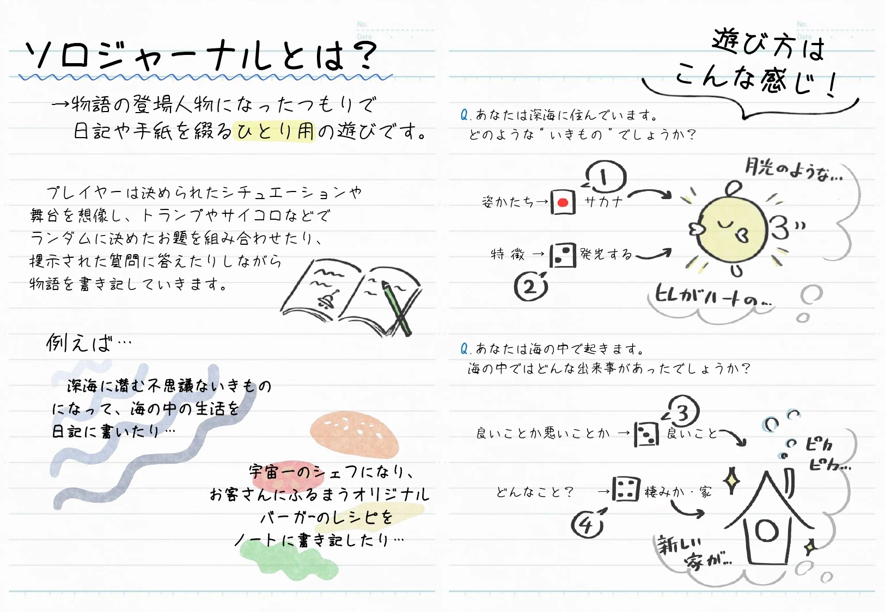

深海に棲む不思議ないきものになりきって、その生活を想像し日記に綴る、ひとり用のジャーナリングRPGです。サイコロで姿や大きさ、特徴を決め、暗く冷たい海の底での一生を描きます。

あなたは、光の届かない深い海の底で暮らす、まだ名前のないいきもの。サカナかもしれないし、クラゲやナマコかもしれません。透明な体や光る器官、異常な再生能力といった特徴をサイコロで決めたら、種名をつけて日記を書きはじめます。毎日の出来事もサイコロで決まり、最後は子孫を残して、次の世代へ命をつなぎます。

深海の環境や生きものの設定は、海洋学・海岸工学の知識をもとに組み立てています。

## ジャーナリングRPGとは

ジャーナリングRPG（ソロジャーナルとも呼ばれます）は、ひとりで遊ぶゲームです。ゲームごとに用意された舞台やシチュエーションを想像し、物語の登場人物になったつもりで、日記や手紙を書き綴って遊びます。サイコロやカードでランダムに決めたお題を組み合わせたり、問いかけに答えたりしながら、自分だけの物語を書いていきます。

ソロジャーナルの説明資料は、ましゅう様（[X](https://x.com/marshuumallow)）に制作していただきました。

<!-- after -->

## 参考にした本・作品

本作の内容は、海洋学・海岸工学の知識をもとに創作したものです。作品の雰囲気づくりにあたり、次の書籍とゲームを参考にしました（順不同、敬称略）。

- ヘレン・スケールズ 著、林裕美子 訳『深海学 深海底希少金属と死んだクジラの教え』（築地書館、2022年）
- K.K.69『魔法骨董ここに眠る』（ソロジャーナルRPG）
