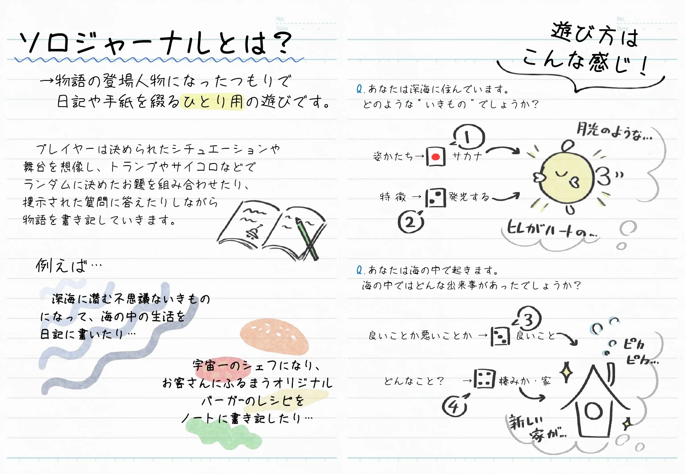

魔法学校に通う魔法使いの卵になって、自分だけの精霊を育てるゲームブックです。冊子を読み進めながら、属性・イベント・成長の3種類のカードを引き、サイコロで出来事の成否を決めて、精霊の性格や姿を想像していきます。

精霊の属性は、火・水・風・地・光・花の6つ。薬草園のお世話や星空観察、空飛ぶほうきレースなど、魔法学校での12の出来事を精霊といっしょに乗り越えながら、「ちからもち」「わすれんぼ」といった特徴を重ねていきます。最後に、あなただけの精霊の名前と姿を思い描いて、物語はおしまいです。

## ジャーナリングRPGとは

ジャーナリングRPG（ソロジャーナルとも呼ばれます）は、ひとりで遊ぶゲームです。ゲームごとに用意された舞台やシチュエーションを想像し、物語の登場人物になったつもりで、日記や手紙を書き綴って遊びます。サイコロやカードでランダムに決めたお題を組み合わせたり、問いかけに答えたりしながら、自分だけの物語を書いていきます。

ソロジャーナルの説明資料は、ましゅう様（[X](https://x.com/marshuumallow)）に制作していただきました。

<!-- after -->

## プレイ用BGM {#bgm}

『Flourish』の世界をイメージしたオリジナルBGMです。遊ぶときに流してみてください。



『Flourish』　Music & Movie：ゆうゆ（[X](https://x.com/yuuyu_ssry)）

イベントカードごとのイメージBGMもあります。

- 「空飛ぶほうきレース！」：[『プライド・フライト』](https://youtu.be/njRnd8vkK3Q)　Music & Movie：ゆうゆ
- 「星空観察」：[『キラボシ』](https://youtu.be/pJc71drg0gY)　Music & Movie：ゆうゆ
- 「星空観察」：[『StarryNight』](https://youtu.be/pudmuuJJo-U)　Music：かなめ／Movie：ゆうゆ
- 「魔法薬草園のお世話」：[『リトル・リドル』](https://youtu.be/59uUWqsBb5w)　Music & Movie：ゆうゆ

すべての曲は[YouTubeの再生リスト](https://youtube.com/playlist?list=PLdWJgpsHGH9lp16gEDw0Xar5iPFF9N9hU)で聴けます。曲は今後も追加していく予定です。
