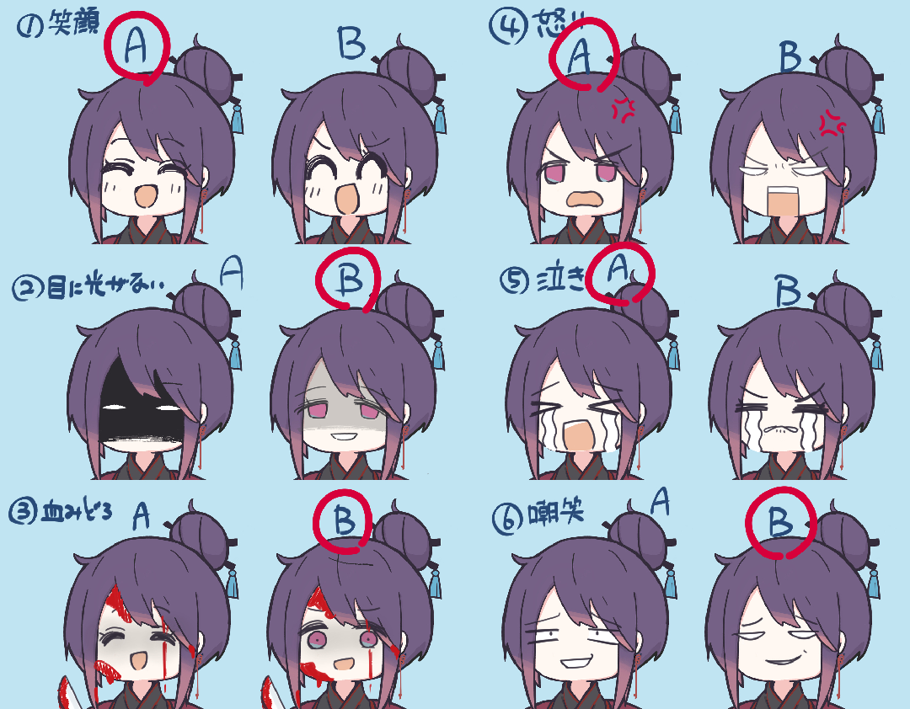

**よるむん様**（[よるむんの広浅ちゃんねる](https://www.youtube.com/@yorumun)）の配信活動向けに、立ち絵／デフォルメ（SD）／YouTubeバナーの3点セットを制作しました。

「**ヨルムンガルドの血を引くヤンデレ系蛇人Vtuber**」ということで、蛇（爬虫類）モチーフを軸に、和洋折衷の要素を取り入れたキャラクターデザインをご提案しています。

制作では、配信スタイル（ゲーム実況中心）とキャラクター像をヒアリングしたうえで、デザインラフを2案作成。方向性確定後に1案を清書し、配信用に扱いやすい立ち絵として仕上げました。

また、追加依頼としてSDキャラクターの表情差分も制作し、配信やSNSでのリアクション表現の幅を広げています。
